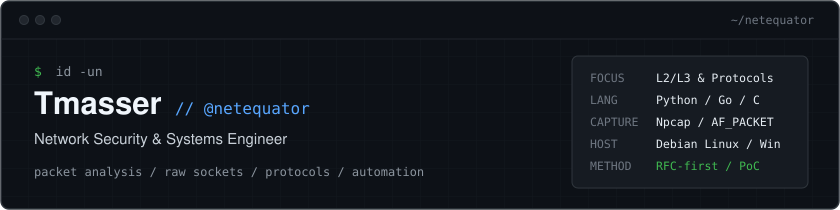

  

## OVERVIEW

Network security and systems engineer working close to the wire: packet capture, raw sockets, protocol parsing, and host-level network automation across Linux and Windows.

Most of my work starts as a single-file proof of concept verifying wire behavior, byte order, and kernel quirks before turning into reusable libraries or CLI tools.

---

## FOCUS AREAS

| Domain | Scope |
| :--- | :--- |
| **Packet Analysis** | Passive L2/L3 monitoring, classic `.pcap` parsing, link-layer framing (`DLT_EN10MB`, `DLT_NULL`, `LINUX_SLL`) |
| **Protocol Engineering** | Wire-format DNS decompression (RFC 1035), ARP/NDP state tracking, raw TCP handshake timing and checksums (RFC 1071) |
| **Anomaly & Telemetry** | Statistical baseline profiling over rolling windows without static IDS signatures |
| **Infrastructure & Security** | Host firewall automation (`nftables`), isolated namespace harnesses (`veth`/`netns`), WireGuard tunnel diagnostics |

---

## PUBLIC REPOSITORIES

| Repository | Purpose | Stage |
| :--- | :--- | :--- |
| [`neighwatch`](https://github.com/netequator/neighwatch) | Passive Layer 2 ARP neighbor monitor and spoof detector emitting normalized JSONL events | `PoC` |

---

## TOOLING & ENVIRONMENT

- **Languages:** `Python 3`, `Go`, `C`
- **Packet & Network Tooling:** `Npcap`, `AF_PACKET`, `Scapy`, `tshark` / `dumpcap`, `Nmap`, `WireGuard`
- **Platforms:** `Debian Linux` (`netns` / `AF_PACKET`), `Windows` (`Winsock` / `Npcap`)

---

## ENGINEERING NOTES

- Read the RFC and inspect the actual capture (`tshark -x`) before wrapping a protocol in abstractions.
- Keep CLI interfaces minimal and machine-readable (`JSONL`, `stdout`, `argparse`).
- Validate active and passive network tools against loopback, synthetic PCAP fixtures, or isolated `veth` pairs.
- Document threat models, endianness rules, and OS-specific socket quirks in code rather than restating syntax.
